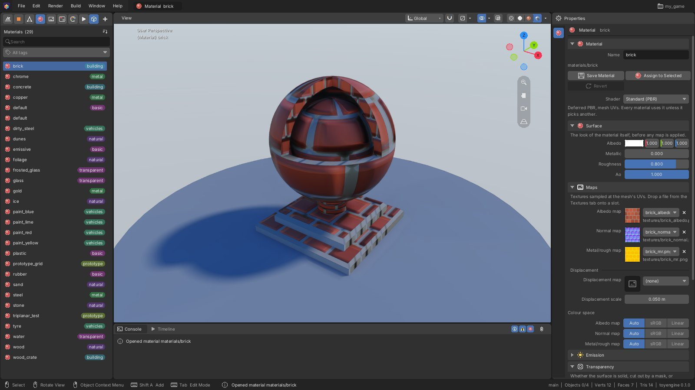

[Editor manual](README.md) > Materials and textures

A material decides how a surface looks: its colour, how shiny or metallic it is, whether it
glows or lets light through, and which textures it uses. You edit materials in the material
editor, which shows the material on a preview shape under studio lighting.

*The **brick** material open in the material editor.*

What you see:

- **Materials** in the Asset panel on the left, with the open material highlighted.
- The viewport shows the material on a preview shape, here the **Shader Ball**, standing on a
  ground disc. You can orbit and zoom, but there is nothing to select in this view.
- **Properties** on the right has one **Material** tab: **Material**, holding the material's
  settings grouped into panels, and **Preview**, which controls the preview shape.

## Create a material

1. Open **Materials** in the Asset panel.
2. Click the **+** button and choose a starting point.

The material is created and opened, ready to edit. The starting points are:

| Preset | What you get |
|---|---|
| **Plain** | Mid-grey, half rough: the blank slate |
| **Metal** | Bare metal, fairly polished |
| **Plastic** | Coloured, non-metallic, slightly glossy |
| **Rough Stone** | Matte grey-brown |
| **Glass** | See-through and refracting, ready to tint |
| **Emissive** | Dark, with a warm glow |
| **Foliage** | A cut-out leaf material on the Foliage shader, ready for an alpha mask |

A preset only writes the few settings that make its look; everything else stays at the
defaults, so you are starting from a material, not unpicking one.

You can also turn an object's own material into a reusable one: see
[Assign a material to an object](#assign-a-material-to-an-object).

Right-click a material in the Asset panel for **Open**, **Assign to Selected**, **Duplicate**,
**Rename...**, **Delete...** and **Copy Path**.

## Edit a material

1. Click the material in **Materials** in the Asset panel.
2. Change its settings in the **Material** panel. The preview updates as you go.
3. Click **Save Material**, or press **Ctrl+S**.

The **Name** box at the top renames the material and updates every scene, object and material
that refers to it, so a rename never leaves anything pointing at a file that has gone. The line
under it shows **(modified)** while there are unsaved changes; **Revert** throws those away and
reads the file back from disk. Saving updates every object that uses the material. Press
**Ctrl+Z** and **Shift+Ctrl+Z** to undo and redo. If you open another asset before saving, the
editor asks whether to save or discard.

The settings are grouped into panels, and a setting that would do nothing is not shown — the
alpha cutoff only appears for a **MASK** material, the refraction settings only once
**Refraction** is ticked, the cel-shading settings only once **Toon bands** is above 1.

### Surface

| Setting | What it changes |
|---|---|
| **Albedo** | The base colour |
| **Metallic** | From 0 (plastic, wood, stone) to 1 (bare metal) |
| **Roughness** | From 0 (mirror-smooth, sharp reflections) to 1 (matte) |
| **Ao** | Darkens the surface's crevices; 1 leaves it unchanged |

### Maps

Each map is a slot showing the image itself. Pick a texture from the list, drag one from
**Textures** in the Asset panel onto the slot, or click **x** to clear it.

| Setting | What it changes |
|---|---|
| **Albedo map** | A texture for the base colour |
| **Normal map** | A texture that adds surface bumps and detail without extra geometry |
| **Metal/rough map** | A texture that varies metalness and roughness across the surface |
| **Displacement map** | A height map that moves the surface itself, on an object with tessellation |
| **Displacement scale** | How far a white pixel of that map pushes the surface, in metres |

Under the slots, **Colour space** says how each map is read. Leave it on **Auto** unless you
know otherwise: colour images are read as **sRGB** and data images (normals, masks, roughness)
as **Linear**, which is right almost always. Reading a normal map as sRGB is a classic cause of
lighting that looks subtly wrong everywhere.

### Emission

| Setting | What it changes |
|---|---|
| **Emissive** | The colour the surface glows with |
| **Emissive strength** | How brightly it glows; 0 is no glow |

A glowing surface lights nothing around it — add a light for that.

### Transparency

| Setting | What it changes |
|---|---|
| **Alpha mode** | **OPAQUE**: solid. **MASK** / **CUTOUT**: fully solid or fully cut away, for leaves and fences. **BLEND**: see-through, like glass |
| **Alpha** | How solid the surface is, from 0 (invisible) to 1 |
| **Alpha cutoff** | With **MASK**, the point below which the surface is cut away |
| **Alpha mask** | A texture that cuts away parts of the surface |
| **Cull backfaces** | When ticked, the back of each face is not drawn. Untick it for thin, two-sided surfaces |

### Refraction

Only for a **BLEND** material. Tick the panel's checkbox to switch it on.

| Setting | What it changes |
|---|---|
| **Ior** | How strongly refraction bends; water is about 1.33, glass about 1.5. -1 uses the project's setting |
| **Refraction thickness** | How thick the refracting material appears. -1 uses the project's setting |
| **Refraction tint** | The colour that light picks up passing through |

### Stylize

Cel shading, on top of everything above. Solid materials only.

| Setting | What it changes |
|---|---|
| **Toon bands** | How many steps the lighting is cut into; 0 leaves the material fully realistic |
| **Toon specular** | The shape of the highlight's edge |
| **Toon rim** | A bright edge on the lit side of each light |
| **Toon softness** | How soft each step's edge is |
| **Toon outline** | Draws the outline on this material, when the project's outline mode is **Toon** |

### Weather

**Snow** lets the weather's snow settle on this material's upward-facing surfaces. Untick it
for anything snow must never whiten.

Click a colour swatch to pick a colour. Settings that no panel claims appear under **More** at
the bottom, so nothing is ever hidden from you.

## Choose a surface shader

The **Shader** list at the top chooses how the material is drawn. Most materials
use **Standard (PBR)**. The others suit special surfaces:

| Shader | Use it for | Its own settings |
|---|---|---|
| **Standard (PBR)** | Almost everything | None |
| **Triplanar** | Rock, cliffs and terrain: textures are projected from three sides, so they don't stretch and need no UVs. Solid surfaces only | **Tiling**, **Blend sharpness**, **Space** (**World** or **Object**), **Normal strength** |
| **Foliage** | Grass, bushes, tree canopies and leaf cards that bend in the World tab's wind and its gusts. Use it with an **Alpha mask** for cards | **Flexibility** (how far the tips sway: grass ~0.35, bushes ~0.1, canopies ~0.04), **Flutter rate**, **Height** (the plant's height in its mesh's units), **Up axis** |
| **Water** | Water surfaces, with waves, depth colour and foam | None; the object's water settings control it |

Switching shader resets the shader's own settings to their defaults. Choosing **Water** also
sets **Alpha mode** to **BLEND**, because water is always see-through.

## Preview a material

The **Preview** panel under **Material** changes what the viewport shows. These options only
affect the preview, not the material.

| Option | What it does |
|---|---|
| **Shape** | **Shader Ball**, **Sphere**, **Rounded Cube**, **Plane** or **Cylinder** |
| **Turntable** | Slowly spins the shape |
| **Ground** | Shows or hides the ground disc |

The **Shader Ball** combines curved and flat areas, sharp edges and a shadowed hollow, so you
can judge the material on all of them at once.

## Assign a material to an object

Any of these gives a scene object a material:

- Drag the material from **Materials** in the Asset panel onto the object in the viewport.
- Select the objects, then right-click the material in the Asset panel and choose **Assign to
  Selected**. The same button is at the top of the material editor.
- Select the object and pick the material in its **Materials** tab in Properties.

The **Materials** tab shows a preview ball and the material's name. The three buttons under it
choose where the object's material comes from:

| Choice | What it means |
|---|---|
| **Inline** | The object has its own material, edited right here with the same settings as the material editor |
| **Asset** | The object uses a shared material. Pick it under **Asset**; **Edit Material Asset** opens it in the material editor |
| **Asset +** | The object uses a shared material but changes a few settings. Click **+ Override...** to choose a setting to change |

With **Asset +**, later edits to the shared material still reach the object, except
for the settings it overrides. To reuse an inline material on other objects, click **Save as
Material Asset**: it becomes a new material in the Asset panel, and the object switches to
using it.

## Give each slot of a mesh a material

A mesh can be split into material slots, groups of faces that each take their own material (see
[Modeling](modeling.md#give-parts-of-a-mesh-different-materials)). When an object's mesh has
more than one slot, its **Materials** tab shows a **Slot Materials** panel:

1. Set the material for the first slot with the **Material** setting above, as usual.
2. In **Slot Materials**, find the row named after another slot.
3. Pick a material for it, or leave it at **(same as ...)** to use the first slot's material.

## View and use textures

Textures are images. **Textures** in the Asset panel lists your project's images.

- **Add a texture:** copy the image file into your project's `assets/textures/` folder. It
  appears in the list. There is no **+** button for textures.
- **Look at a texture:** click it. The viewport shows it on a flat plane, and Properties shows
  its file name and size.
- **Use a texture:** pick it in one of a material's map slots, or drag it there from the Asset
  panel. Map slots accept `.png` images and show the image itself once it is set.

Editing textures inside the editor is not yet available.

---
Sources: `editor/app/asset_documents.h`, `editor/app/ui/properties.inl`, `editor/app/ui/assets.inl`, `editor/app/editor_app.h`, `editor/schema/component_schema.h`, `editor/schema/inspector.h`, `editor/mesh/shader_ball.h`

Previous: [Sculpt and paint](sculpt-and-paint.md) | Next: [Animation](animation.md)
