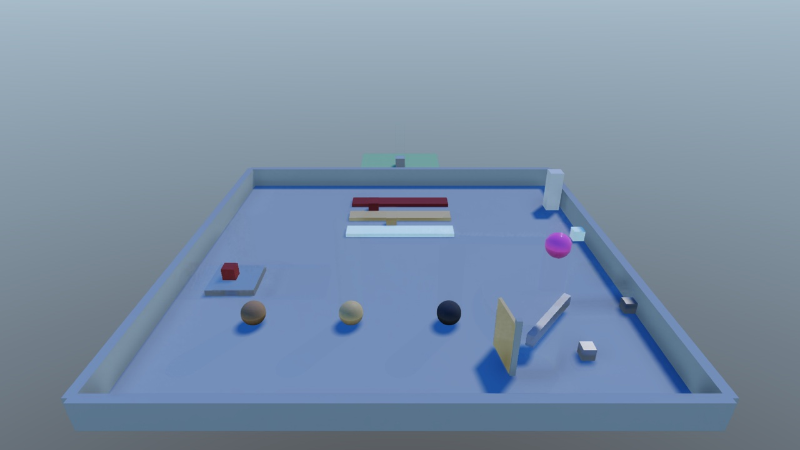
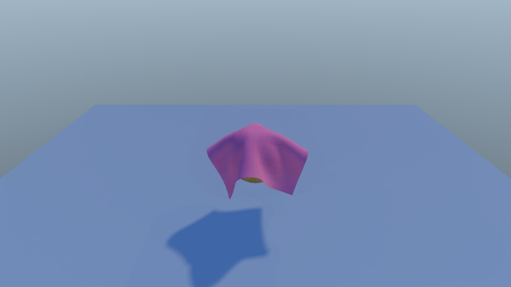

# physxcoopa

**A header-only C++20 library for real-time rigid-body and cloth physics.**

physxcoopa simulates rigid bodies with box, sphere, capsule and triangle-mesh colliders,
hinge, ball and cone-twist joints, triggers and XPBD cloth, drives raycast-wheel vehicles, and builds navigation (A* and flow fields for crowds)
from those same colliders. It has two layers. `PhysicsWorld` is a plain
simulation you can drive from any program. `PhysicsSystem` is an optional adapter that binds
the world to a [libcoopa](https://github.com/cooparobla/libcoopa) scene, so colliders and
rigid bodies can be written as YAML components. The library has no renderer. It gives you
debug geometry as plain line segments to draw however you like.

<table>
  <tr>
    <td></td>
    <td></td>
  </tr>
  <tr>
    <td align="center"><sub>Restitution, friction, stacking, hinges and triggers</sub></td>
    <td align="center"><sub>XPBD cloth pinned to a moving ball</sub></td>
  </tr>
</table>

<sub>Both scenes are simulated by physxcoopa and rendered by
[toyengine](https://github.com/cooparobla/toyengine), one of its users.</sub>

## Features

### Rigid bodies
- **Z-up, in metres.** Gravity defaults to `{0, 0, -9.81}`. A capsule's default axis is Z.
- **Static, kinematic and dynamic bodies.** Kinematic bodies take their velocity from how far
  they moved, so they carry and push dynamic bodies.
- **Colliders.** Box, sphere, capsule, convex hull and triangle mesh. Several colliders under
  one rigid body form a compound body. Colliders can have a local offset (`center`).
- **Sequential-impulse solver.** Warm starting, a separate restitution pass and split-impulse
  position correction. Stacks settle and stay put.
- **Physics materials.** Static and dynamic friction, restitution, and Unity-style combine
  modes (`Average`, `Minimum`, `Maximum`, `Multiply`).
- **Sleeping.** Bodies are grouped into islands, and an island sleeps once it has been still for
  a short time.
- **Fast bodies.** Speculative contacts stop fast spheres and boxes from passing through thin
  walls. A speed cap covers the remaining cases.
- **Joints.** Three types share one solver path (`dynamics::Joint`, `JointType`):
  - **Hinge**: one rotational degree of freedom about an axis, optional angle limits; a zero
    range gives a rigid weld.
  - **Ball**: the anchors are held together, every rotation is free.
  - **ConeTwist**: a ball joint whose twist axis may swing at most `swing_limit` away from its
    rest direction (a cone) and twist within `[twist_min, twist_max]` -- shoulders, hips, necks.

  The point constraint is solved as one 3x3 block (the lever arms of an off-centre anchor
  couple the axes); limits are one-sided and speculative (a fast spin stops at the limit, not a
  substep past it); drift is corrected on the integrated poses at the end of each substep;
  joint passes alternate direction (symmetric Gauss-Seidel) so chains converge both ways; a
  sleeping body jointed to an awake one is woken with it. Limits are measured from the rest
  pose: the bodies' relative orientation when the joint is added, or any rest pose given to
  `add_joint()`. Jointed pairs do not collide unless `collide_connected`;
  `set_pair_collision(a, b, false)` turns any other pair off (a ragdoll's neighbouring bones).
  No motors or springs.
- **Per-axis freezing** of position and rotation, center-of-mass and inertia overrides, linear
  and angular drag.
- **Gravity sources** (planets). `add_gravity_source({centre, strength, radius, range})` adds a
  point pull: `strength` up to `radius`, falling off with the square of the distance beyond it,
  none past `range` (0: everywhere). `gravity_at(p)` is the strongest source acting at `p`, else
  the uniform gravity; `up_at(p)` points away from that source (even one at zero strength). Every
  body integrates the pull at its own position, cloth the pull at its centre. With no sources --
  every scene that does not add one -- the step is exactly the uniform-gravity step.

### Collision and queries
- **Broadphase.** Two dynamic AABB trees (static and moving) and a persistent pair cache.
- **Layers.** 32 collision layers with a layer matrix. Layers can have names.
- **Events.** Collision and trigger enter, stay and exit. Collision events carry the contact
  points, normal, relative velocity and impulse.
- **Queries.** `raycast`, `raycast_any`, `raycast_all`, `shape_cast`, `sphere_cast`,
  `box_cast`, `capsule_cast`, `overlap_sphere`, `overlap_box`, `overlap_capsule` and
  `compute_penetration`. Each takes a `query::QueryFilter`: a layer mask, an option to skip
  triggers, one body to ignore, and an optional predicate. The older
  `(layer_mask, include_triggers)` overloads still work.
- **Exact shape casts.** Sphere and capsule casts use conservative advancement on exact
  closest distances. Box casts use a swept separating-axis test against boxes and triangles.
  Casts are exact against every collider type, meshes included. Hits report the shape slot
  that was hit and a `started_inside` flag.
- **Penetration.** `compute_penetration` returns one minimum-translation vector per overlapped
  surface. A character motor uses it to resolve overlaps before sweeping.
- **Mesh colliders.** Meshes are welded and get a BVH. Contacts, casts and penetration tests
  only test the triangles the BVH returns. Internal edges are corrected, so a box slides across
  a tiled floor without catching on seams. A box rests on a mesh by its corners that are over a
  triangle plus the triangle vertices inside it, reduced to four well-spread points; a face the
  box's centre is behind is ignored, so a ledge's wall never pushes a box off it. Runtime
  geometry needs no asset: `TriangleMesh::from_triangles()` welds and builds adjacency, and
  `MeshCollider::set_mesh()` takes the result by `shared_ptr`.

### Vehicles
- **Raycast wheels.** The chassis is an ordinary dynamic body; each wheel is a ray from its
  chassis-local anchor, and its hit is the contact patch. Suspension is a spring-damper with
  separate bump and rebound rates and an anti-roll bar across each axle; the spring rate can be
  given directly or derived from a corner's natural frequency.
- **A real tyre curve.** Longitudinal and lateral force each rise with slip to a peak and fall to
  a plateau, and the two are clamped together on a **friction circle** -- so a wheel spending its
  grip accelerating has none left to corner with. Grip scales with the ground's own
  `PhysicsMaterial`, which is what makes tarmac, gravel, mud and ice drive differently.
- **Drivetrain.** A three-point engine torque curve, an automatic or manual gearbox, and open,
  limited-slip or locked differentials. Reverse is selected by holding the brake at a standstill.
- **Steering.** Rate-limited, speed-sensitive lock, Ackermann-split across a steered axle -- or
  `Differential` (skid) steering, which drives the two sides against each other so a tracked
  machine pivots on the spot.
- **Aero and air.** Quadratic drag, speed-squared downforce, and an optional righting torque so a
  vehicle that jumps lands on its wheels.
- **Recovery.** One control rights a vehicle that has ended up on its roof: it floats clear, turns
  smoothly back upright about the heading it had, and lands on its suspension. Optionally
  automatic after a few seconds.
- **Six tunings** ship by name: `sports_car`, `pickup_4x4`, `hauler_6x6`, `buggy`, `dozer`,
  `trailer`. They share one code path; only the numbers differ.
- **Scene component.** `Vehicle` + `install_vehicle_system()`, with the wheel visuals placed from
  the simulation each frame. See
  [`physxcoopa/vehicle/README.md`](physxcoopa/vehicle/README.md) -- including the traps, each of
  which reads as a mistuned vehicle rather than as a bug.
- Mud is a friction and rolling-resistance **surface**, not a deformable one: no ruts.

### Character motor
- **`character::move()`** moves a kinematic capsule by a desired displacement and reports where
  it ended up: grounded or not, the ground normal, body and (for a kinematic ground) velocity,
  ceiling hits and every surface touched. It is pure algorithm over the queries above, with no
  scene types and no state between calls.
- **Each move** depenetrates, then collides and slides with a skin gap, steps up ledges no taller
  than `step_height`, treats slopes steeper than `slope_limit_deg` as walls (and slides down
  them), and snaps down to the ground by `snap_distance` while grounded.
- **Any up.** `MoveOptions::up` (default +Z) sets which way is up for the move -- the walkable
  test, step-up, snap and the capsule's orientation -- so a capsule can walk round a planet with
  `up = world.up_at(position)`.
- A gameplay controller on top of it (velocity, jumps, platforms, pushing) lives in toyengine's
  `CharacterController`. See [`physxcoopa/character/README.md`](physxcoopa/character/README.md).

### Cloth
- **XPBD cloth** with many small substeps. Stretch and bend constraints, tethers, Coulomb
  friction, and optional self-collision.
- **Collides with every rigid shape**, including meshes and moving bodies.
- **Pinning.** Pin regions of a sheet to the world or to a rigid body, and the sheet follows it.
  Coupling is one-way: the cloth never pushes bodies.
- **Wind and air.** Wind, turbulence, drag and lift.
- **Sleeping.** A settled sheet stops simulating until an anchor or a nearby collider moves.

### Damage
- **Typed blows, not one scalar.** `damage::DamageType` (Impact/Slash/Pierce/Explosive/Fire) each
  read a `DamageMaterial`'s per-type `resistance` plus its `hardness`/`toughness`/`fibrous`
  differently -- `resolve_damage()` is the one function that decides an axe cleaves what a
  bullet punches through, and the same impulse means neither. `impact_blow()` turns a solved
  contact's accumulated normal impulse into an Impact blow; a `DamageDealer` on the other
  collider overrides the type (a swung axe reads as Slash, not the generic Impact a bare
  contact would otherwise read as).
- **Pure, scene-free.** `DamageEvent`/`DamageMaterial`/`ResolvedDamage` carry no scene or mesh
  types; the localized accumulation that actually carves a mesh (`DamageField`, `Damageable`)
  is one layer up, in toyengine. See [`physxcoopa/damage/README.md`](physxcoopa/damage/README.md).
- **Scene component.** `DamageDealer`, parsed in `physx_yaml.h`.

### Navigation
- **Navmesh from colliders.** Static and kinematic colliders are voxelized, tile by tile, into a
  multi-layer walkable surface per agent profile (radius, height, climb). Stairs, ramps, bridges
  and stacked floors are ordinary surface, so paths go upstairs by themselves.
- **A\*.** Hierarchical (coarse region corridor, then fine 8-way search), with an O(1)
  reachability check, area costs and masks, off-mesh links (jumps, drops, ladders), partial
  paths and string pulling. Batches run in parallel on the job engine.
- **Flow fields.** Fast Marching (Eikonal) integration over the same surface, so one field
  steers thousands of agents toward one or more goals, across floors. Built in the background
  and swapped in. In open worlds they go **hierarchical**: coarse portal routing for the whole
  world, exact integration only in the tiles around the followers.
- **Crowds.** Path or flow following, separation, overlap resolve, arrival contagion, wall
  sliding and link traversal, updated in parallel.
- **Incremental.** Moving or adding a collider rebuilds only the tiles it touches, in the
  background. A dynamic body can carve the mesh once it comes to rest.
- **Scene components.** `NavAgent`, `NavModifier`, `NavVolume`, `NavLink`, plus
  `install_nav_system()`. See [`physxcoopa/nav/README.md`](physxcoopa/nav/README.md).

### Engine integration
- **Fixed timestep.** `step(dt)` runs fixed substeps (1/60 s by default) and exposes an
  interpolation factor for smooth rendering.
- **Deterministic.** `world_state_hash()` hashes every body's state, and the tests check that
  repeated runs, and serial versus multithreaded runs, give identical results.
- **Optional multithreading** on libcoopa's job engine. Without one, everything runs on the
  calling thread.
- **Debug drawing.** Collider wireframes, contacts, joints and broadphase nodes as colored line
  segments.
- **Scene components.** `BoxCollider`, `SphereCollider`, `CapsuleCollider`, `MeshCollider`,
  `ConvexCollider`, `Rigidbody`, `HingeJoint`, `BallJoint`, `ConeTwistJoint`, `Cloth` and
  `Vehicle`, with YAML parsers and Unity-style collision callbacks.

## Getting started

### 1. Clone

physxcoopa builds on [libcoopa](https://github.com/cooparobla/libcoopa) (scene graph, assets,
events, jobs; it also provides glm and fkYAML). Its `CMakeLists.txt` looks for libcoopa in a
folder named `libcoopa` next to the top-level project, unless a `coopa::lib` target already
exists. Clone the two side by side:

```bash
git clone git@github.com:cooparobla/libcoopa.git
git clone git@github.com:cooparobla/physxcoopa.git
```

### 2. Build

You need CMake 3.20 and a C++20 compiler. There is nothing to compile for the library itself.
Building the repo on its own builds the test program:

```bash
cd physxcoopa
cmake -B build && cmake --build build -j
```

### 3. Add it to your project

Add libcoopa first, then physxcoopa, and link `coopa::physx`:

```cmake
add_subdirectory(path/to/libcoopa)
add_subdirectory(path/to/physxcoopa)
target_link_libraries(my_game PRIVATE coopa::physx)
```

When physxcoopa is added this way, it defines only the `coopa::physx` target, not its tests.

### 4. Simulate without a scene

`PhysicsWorld` needs no scene. You create bodies and step it yourself:

```cpp
#include <physxcoopa/world.h>

using namespace coopa::physx;

PhysicsWorld world;  // gravity defaults to {0, 0, -9.81}

// Static floor: a box with half extents 5 x 5 x 0.5, top face at z = 0.
dynamics::Body ground;
ground.type = dynamics::BodyType::Static;
ground.position = {0.0f, 0.0f, -0.5f};
world.add_body(ground, collision::Shape::make_box({5.0f, 5.0f, 0.5f}));

// Dynamic ball, radius 0.5, dropped from 5 m.
dynamics::Body ball;
ball.position = {0.0f, 0.0f, 5.0f};
ball.mass = 2.0f;
ball.inv_mass = 1.0f / ball.mass;
ball.inv_inertia_local = dynamics::sphere_inverse_inertia(0.5f, ball.mass);
dynamics::BodyId id = world.add_body(ball, collision::Shape::make_sphere(0.5f));

for (int frame = 0; frame < 180; ++frame) {
    world.step(1.0f / 60.0f);  // runs as many fixed substeps as the time calls for
    for (const collision::ContactEvent& ev : world.events()) {
        if (ev.type == collision::ContactEvent::Type::Enter) { /* first touch */ }
    }
}

float z = world.get_body(id)->position.z;  // about 0.5: the ball rests on the floor

query::RaycastHit hit;
geometry::Ray ray{{0.0f, 0.0f, 10.0f}, {0.0f, 0.0f, -1.0f}, 100.0f};
if (world.raycast(ray, hit)) { /* hit.point, hit.normal, hit.distance, hit.body */ }

// Sweep a capsule forward, ignoring the body it belongs to.
query::QueryFilter filter;
filter.ignore = id;
filter.include_triggers = false;
collision::Shape capsule = collision::Shape::make_capsule(0.3f, 0.6f);
if (world.shape_cast(capsule, {0, 0, 1}, glm::quat(1, 0, 0, 0), {1, 0, 0}, 5.0f, hit, filter)) {
    // hit.distance: how far it can move; hit.normal points back toward the capsule
}
for (const query::Penetration& p : world.compute_penetration(capsule, {0, 0, 1}, glm::quat(1, 0, 0, 0), filter)) {
    // move by p.normal * p.depth to separate from p.body
}
```

You set a body's mass, inverse mass and inverse inertia yourself. `dynamics/inertia.h` has
helpers for each shape. `Shape::make_box` takes half extents.

### 5. Simulate a scene

With a libcoopa scene, register the component parsers once, load the scene, then install the
system. `Scene::update()` steps physics along with every other scene system:

```cpp
#include <physxcoopa/physx_yaml.h>
#include <coopa/scene/scene_loader.h>

coopa::asset::AssetManager assets;
coopa::physx::register_physics_components(assets);  // before any SceneLoader::load()

coopa::scene::Scene scene = coopa::scene::SceneLoader::load("assets/scene.yaml");
auto* physics = coopa::physx::system::install_physics_system(scene);

// Game loop:
scene.update(dt);
scene.late_update(dt);
```

Colliders bind to bodies, and an object needs a collider for its `Rigidbody` to simulate.
Collider components without a `Rigidbody` are static. Collider sizes are full sizes, and they
scale with the object's transform.

```yaml
scene:
  scene_name: PhysicsHello
  root_objects:
    - name: ground
      components:
        - type: Transform
          position: { x: 0.0, y: 0.0, z: -0.5 }
        - type: BoxCollider
          size: { x: 20.0, y: 20.0, z: 1.0 }
          material: ice                 # loads physics_materials/ice.yaml
    - name: crate
      components:
        - type: Transform
          position: { x: 0.0, y: 0.0, z: 3.0 }
        - type: BoxCollider
          size: { x: 1.0, y: 1.0, z: 1.0 }
          material: { dynamic_friction: 0.4, static_friction: 0.5, restitution: 0.2 }
        - type: Rigidbody
          mass: 4.0
          freeze_rotation: { x: false, y: false, z: true }
    - name: pickup
      components:
        - type: Transform
          position: { x: 3.0, y: 0.0, z: 0.5 }
        - type: SphereCollider
          radius: 0.5
          is_trigger: true
```

A shared material is a small YAML file, `physics_materials/<name>.yaml`, next to the scene:

```yaml
dynamic_friction: 0.05
static_friction: 0.05
restitution: 0.1
friction_combine: Minimum
```

From code, use the components and the system:

```cpp
using namespace coopa::physx;

auto* crate = scene.find_object("crate");
crate->get_component<components::RigidbodyComponent>()->add_impulse({0.0f, 0.0f, 5.0f});

crate->get_component<components::BoxCollider>()->on_collision_enter.connect(
    [](components::Collider& self, const components::Collision& c) {
        // c.object, c.normal, c.impulse, c.contacts[0 .. c.contact_count)
    });

system::PhysicsSystem::RaycastHit hit;   // resolves to collider, object and rigidbody
if (physics->raycast(geometry::Ray{{0, 0, 10}, {0, 0, -1}, 100.0f}, hit)) { /* hit.object */ }

system::PhysicsSystem::QueryFilter filter;   // scene-level filter
filter.ignore_rigidbody = crate->get_component<components::RigidbodyComponent>();
physics->sphere_cast({0, 0, 2}, 0.25f, {1, 0, 0}, 10.0f, hit, filter);  // skips the crate
```

For code that must run once per fixed substep, derive from `components::FixedUpdateBehaviour`
and override `fixed_update(PhysicsWorld&, float h)`. Call `physics->refresh()` after adding or
removing colliders at runtime.

## Component reference

Every key is optional.

| Component | Keys |
|---|---|
| All colliders | `center`, `is_trigger`, `enabled`, `layer` (index or layer name), `material` (asset name or inline mapping) |
| `BoxCollider` | `size` |
| `SphereCollider` | `radius` |
| `CapsuleCollider` | `radius`, `height` (total, including the caps), `direction` (0, 1 or 2 for X, Y or Z; default 2) |
| `MeshCollider` | `mesh_path` (loads `meshes/<name>.yaml`, a `vertices:`/`faces:` mesh), `convex` |
| `ConvexCollider` | `hull_mesh` (loads `meshes/<name>.yaml`; the hull is built from its vertices lazily, once) — legal on a dynamic `Rigidbody`, unlike `MeshCollider` |
| `Rigidbody` | `mass`, `drag`, `angular_drag`, `use_gravity`, `is_kinematic`, `interpolation` (`Interpolate` or `None`), `freeze_position`, `freeze_rotation`, `velocity`, `angular_velocity` |
| `HingeJoint` | `connected_object`, `anchor` and `axis` (in this object's local frame), `limits: { min, max }` (degrees; or flat `use_limits`, `min_angle`, `max_angle`), `enable_collision` |
| `BallJoint` | `connected_object`, `anchor` (this object's local frame), `enable_collision` |
| `ConeTwistJoint` | `connected_object`, `anchor`, `axis` (the twist axis, this object's local frame), `swing_limit` (cone half-angle in degrees; negative = free), `twist: { min, max }` (or `twist_min` / `twist_max`; min > max = free), `enable_collision` |
| `NavAgent` | `agent_type`, `speed`, `acceleration`, `angular_speed`, `stopping_distance`, `slowdown_distance`, `radius`, `separation_weight`, `base_offset`, `update_rotation`, `forward` (`Y`, `-Y`, `X`, `-X`), `avoid_areas`, `heuristic_weight`, and one of `destination` (A\* to a point), `destination_object` (chase an object by A\*), `flow_target` (follow that object's shared flow field) |
| `NavModifier` | `area`, `walkable`, `ignore`, `carve` (dynamic bodies carve while asleep), `apply_to_children` |
| `NavVolume` | `size`, `center`, `area` (`NotWalkable` cuts a hole) |
| `NavLink` | `start`, `end` (local space), `bidirectional`, `cost`, `area`, `snap_radius` |
| `Cloth` | `resolution`, `size`, `mass`, `shear`, `stretch_compliance`, `bend_compliance`, `damping`, `thickness`, `friction`, `gravity_scale`, `max_velocity`, `external_acceleration`, `wind`, `wind_turbulence`, `air_drag`, `air_lift`, `self_collision`, `self_distance`, `tether_scale`, `substeps`, `iterations`, `sleep_threshold`, `sleep_time`, `layer`, `anchors: [{ object, point, radius }]` |
| `DamageDealer` | `damage_type` (Impact/Slash/Pierce/Explosive/Fire; not `type`, which every component node's own YAML tag already owns), `amount` (non-Impact blows), `amount_from_impulse` (1; scales the contact impulse for an Impact blow), `edge_axis` (Slash's blade direction), `radius` (0 = the receiver's default), `one_shot` (false) |

A cloth sheet is built in its object's local XY plane, centred on the object. Each anchor pins
the particles within `radius` of `point`. With `object`, the point is in that object's local
frame and the pinned particles follow its rigid body. Without it, the point is in world space and
the particles stay fixed.

Project-wide settings come from a `physics:` YAML block. Parse it with
`util::parse_physics_settings()` and pass the result to `register_physics_components()` (for
layer names) and `install_physics_system()`:

```yaml
physics:
  gravity: { x: 0.0, y: 0.0, z: -9.81 }
  fixed_timestep: 0.016666
  solver: { velocity_iterations: 16, position_iterations: 4, max_substeps: 8 }
  cloth: { substeps: 4, iterations: 1 }
  layers: [Default, Ground, Triggers]
  ignore_layer_collisions:
    - [Triggers, Triggers]
  debug_draw: [Colliders, Contacts]
  parallel_threshold: 64
```

Navigation is configured by a `navigation:` block. Parse it with `nav::parse_nav_settings()`
and pass the result to `system::install_nav_system(scene, settings)`, which must run after
the physics system (default order 150). The system idles until the scene has a `NavAgent`.

```yaml
navigation:
  cell_size: 0.25              # XY resolution; paths and flow vectors have this resolution
  cell_height: 0.05
  max_slope: 45
  agents:
    - { name: Humanoid, radius: 0.4, height: 1.8, max_climb: 0.45 }
  areas:
    - { name: Mud, cost: 8.0 }
  flow: { rebuild_distance: 0.5, wall_penalty: 1.0, mode: auto, near_radius: 12, lookahead_tiles: 2 }
  debug_draw: [Mesh, Links, Paths, Flow, FlowTiles]
```

From code, without a scene:

```cpp
nav::NavBaker baker;                         // NavBuildSettings: cell size, agent profiles, areas
std::vector<nav::SourceShape> sources;
nav::gather_sources(world, {}, sources);     // snapshot the colliders
baker.set_sources(sources);
baker.build_all(&jobs);                      // parallel; later edits: set_sources() + update()

auto mesh = baker.mesh();
nav::NavPath path;
nav::find_path(*mesh, start, goal, mesh->default_filter(), path);   // path.points, 3D

glm::vec3 goals[1] = {goal};
auto flow = nav::FlowField::build(mesh, goals, {}, &jobs);
nav::FlowSample s = flow->sample(position);  // s.direction, s.distance
```

## How a step works

```text
PhysicsWorld::step(dt)
  clamp dt to 0.25 s and add it to the accumulator
  while a full fixed step is due (at most max_substeps times):
    step_fixed(h)
      apply gravity and forces
      broadphase -> layer filter -> narrowphase -> contact manifolds
      emit on_substep
      solve contacts and joints, then update islands and sleep
      integrate positions
  advance every cloth once, on the frame clock

PhysicsSystem::execute(scene, frame)        (UpdatePhase::Physics, order 100)
  after install or refresh(): bind new colliders, joints and cloths; drop removed ones
  apply changed collider and Rigidbody fields
  read transforms in (kinematic velocities, teleports)
  world.step(frame.delta_time)
  write interpolated transforms back, then fire collision and trigger callbacks
```

`step_fixed(h)` runs one substep with no accumulator. It is handy in tests, but it does not
advance cloth. Events from `step()` collect over the whole frame and clear on the next call.

## Testing

```bash
ctest --test-dir build -j8               # one ctest entry per suite: physxcoopa_<suite>
./build/physxcoopa --suite cloth_solver  # one suite; `--list` lists every test, -v is verbose
```

The tests are headless and live in `tests/`, one suite per system in `tests/<suite>_test.cpp`,
written against libcoopa's test framework (`coopa/testing/test.h`). Shared builders (ground,
boxes, hand-built meshes, cloth sheets, nav worlds) are in `tests/support/`.

| Suite | Covers |
| --- | --- |
| `geometry` | ray/AABB, segment closest points, bases, closed-form inertia |
| `physics_world` | free fall vs. the integrator's closed form, handles, impulse/force API, `on_substep`, determinism (repeat and serial vs. job-parallel), debug draw |
| `contact_solver` | restitution, kinematic pushing, tumbling to rest, CCD, stacking, friction, mass ratios, capsules |
| `sleep` | sleeping, kinematic wake rules, joint islands |
| `narrowphase` / `broadphase` | SAT contacts (box, hull, mesh), BVH mesh contacts vs. brute force, internal edges; AABB tree vs. brute force, pair and layer filtering |
| `convex_hull` | hull builder: face merging, volume/centroid, degenerates, determinism, `support()` |
| `damage` | `resolve_damage()`: type x material -> response (Dent/Chip/Hole/Cleave/Fracture/None), resistance scales HP loss monotonically, a settling-contact impulse resolves to None |
| `queries` | exact raycasts, overlaps, sweeps, `QueryFilter`, `compute_penetration` |
| `character_motor` | step-up and slope limit |
| `contact_events` / `joints` | trigger and collision callbacks; hinge, ball and cone-twist joints |
| `physics_system` / `physics_config` | scene binding and runtime changes; materials and settings YAML |
| `cloth_solver` / `cloth_collision` | XPBD solver, anchors, determinism, binding; collider projection and mesh rules |
| `hair_solver` | XPBD strands: pinned roots, inextensibility, the global and local shape constraints, collision, determinism, sleep |
| `nav_build` / `nav_path` / `nav_flow` / `nav_crowd` / `nav_system` | baking, A\*, flow fields, crowds, and the scene system |

## Project layout

```
physxcoopa/
├── world.h        PhysicsWorld: bodies, joints, cloths, hair, stepping, queries, debug draw
├── physx_yaml.h   register_physics_components(): YAML parsers and asset loaders
├── util/          PhysicsConfig, PhysicsSettings, math helpers, transform bridge
├── geometry/      AABB, ray, sphere, OBB, capsule, triangle mesh, mesh BVH
├── collision/     shapes, SAT and clipping, contact manifolds, mesh contacts, events
├── broadphase/    dynamic AABB tree, layer matrix, pair cache
├── dynamics/      bodies, inertia, integrator, islands, joints (hinge/ball/cone-twist), materials, solver
├── cloth/         cloth data, grid builder, collision, XPBD solver
├── hair/          strand data, builder, XPBD solver (reuses cloth's particles and collision)
├── query/         query filter, raycast and overlap helpers, exact sweeps and penetration
├── character/     kinematic capsule character motor (collide-and-slide, steps, slopes, snap)
├── debug/         DebugDraw line output
├── nav/           navigation: voxelized walkable surface, A*, flow fields, crowds
├── damage/        typed damage: DamageEvent/DamageMaterial/resolve_damage()/impact_blow()
├── loaders/       asset loaders for triangle meshes, physics materials and damage materials
├── components/    scene components: colliders, Rigidbody, Hinge/Ball/ConeTwistJoint, Cloth, FixedUpdateBehaviour, DamageDealer, Nav*
├── nav_yaml.h     register_nav_components() (called by register_physics_components())
└── system/        PhysicsSystem, NavSystem and their install functions
tests/             the test suites (tests/support/: shared fixtures)
```

Only `system/`, `components/`, `physx_yaml.h` and `nav_yaml.h` use libcoopa's scene module. `PhysicsWorld`
itself uses only glm and libcoopa's signals, logger and job engine.

## Notes

- **Queries during a substep.** Run queries between steps. Inside an `on_substep` callback the
  bodies are mid-solve.
- **Casts that start in contact.** If a cast starts touching or overlapping a collider, it
  reports a hit at distance 0 only when it moves further into that collider. Moving away from
  it or sliding along it is ignored. For meshes this is decided per triangle. Resolve overlaps
  with `compute_penetration` first. Mesh-shaped casts are not supported.
- **Changing bodies during a substep.** From `on_substep` you can apply forces and set
  velocities. `create_body()` and `destroy_body()` are deferred to the start of the next substep.
- **Mesh colliders are static or kinematic.** A `MeshCollider` on a dynamic `Rigidbody` throws
  when it binds; use a `ConvexCollider` for a dynamic convex body instead.
- **Physics runs before animation.** At its default order (100), physics reads transforms
  before animation (300) writes them. To let animation drive kinematic bodies, install the
  system at a later order, for example `install_physics_system(scene, 325)`.
- **Hierarchical bodies.** A body may sit under another body in the scene hierarchy (a
  ragdoll's bones). The write-back derives each child's local pose from its nearest body
  ancestor's NEW pose (two passes: read every target, then write), so the result is correct in
  any order and race-free on the job-parallel path.
- **Joints and cloth bind once.** Changing a hinge's anchor or a cloth's grid or anchors after
  binding has no effect until the component is re-added. A cloth's runtime parameters, such as
  wind and friction, can change at any time through `ClothComponent::cloth_mut()->params`.

## Documentation

- Each folder under [`physxcoopa/`](physxcoopa/) has its own README with module details.
- The headers are documented in Doxygen style. `world.h`, `physx_yaml.h` and
  `system/physics_system.h` are the best places to start.
